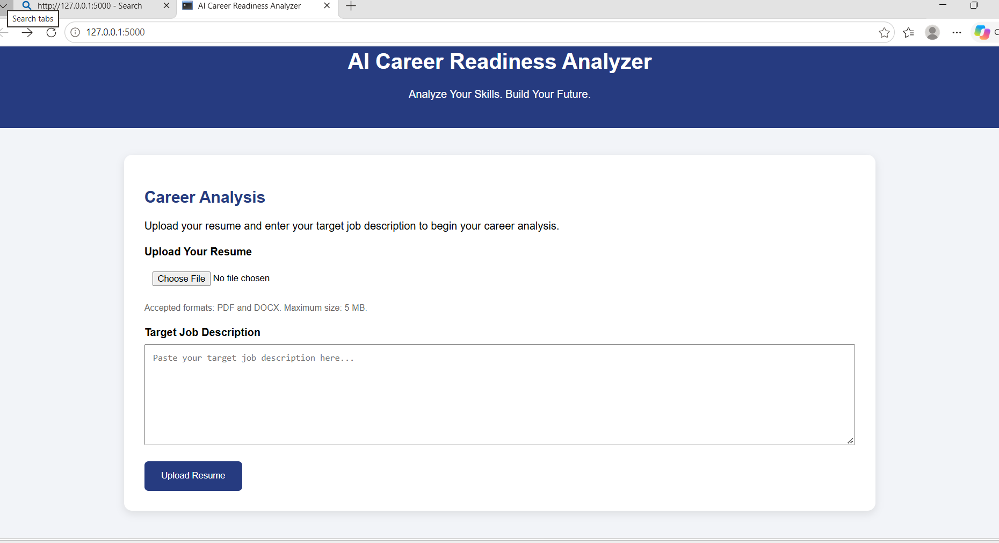

CareerIQ – AI Career Readiness & Skill Gap Analyzer

An AI-powered career readiness and skill gap analysis system designed to help students understand their technical skills and prepare for their target job roles.

About the Project

CareerIQ analyzes a student's resume against a target job description and generates a personalized career readiness report.

Key Features

- Resume Upload (PDF and DOCX)
- Automatic Skill Detection
- Matched and Missing Skills Analysis
- Career Readiness Score
- NLP-Based Text Similarity Analysis
- Personalized Course Recommendations
- Learning Roadmap
- Downloadable PDF Career Report

Technology Stack

- Programming Language: Python
- Backend: Flask
- Frontend: HTML, CSS
- Libraries: Pandas, Scikit-learn, PyPDF2, python-docx, ReportLab

Project Structure

CareerIQ/
├── backend/
│   ├── app.py
│   └── templates/
├── dataset/
├── uploads/
├── requirements.txt
├── README.md
└── .gitignore

How to Run

1. Clone the repository.
2. Create and activate a Python virtual environment.
3. Install dependencies:

pip install -r requirements.txt

4. Run the Flask application:

python backend/app.py

5. Open "http://127.0.0.1:5000" in your browser.

Project Objective

To help students identify skill gaps, explore learning resources, and improve their preparation for career opportunities.

---

Developed as a BCA Academic Project.

## 📸 Project Screenshots

